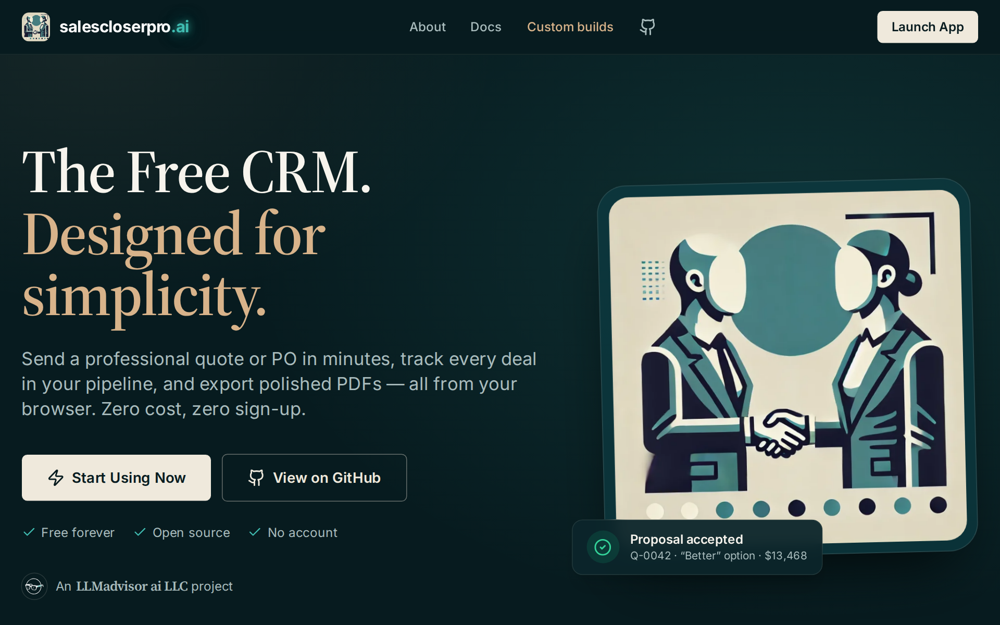
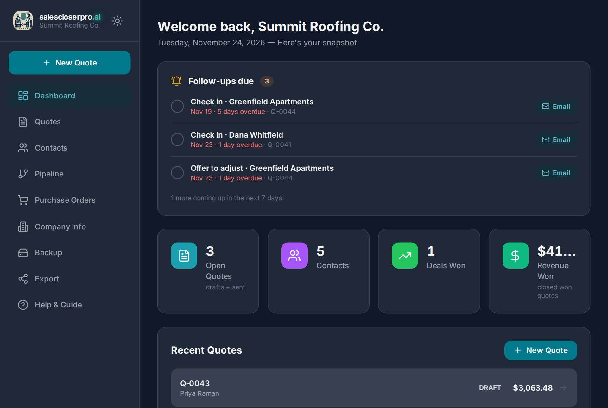
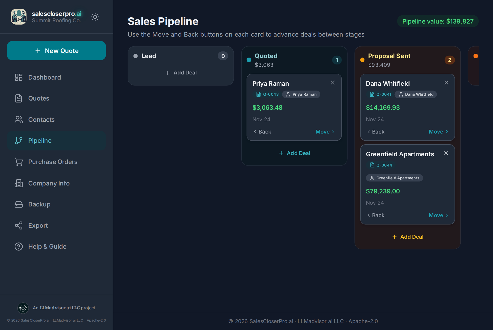
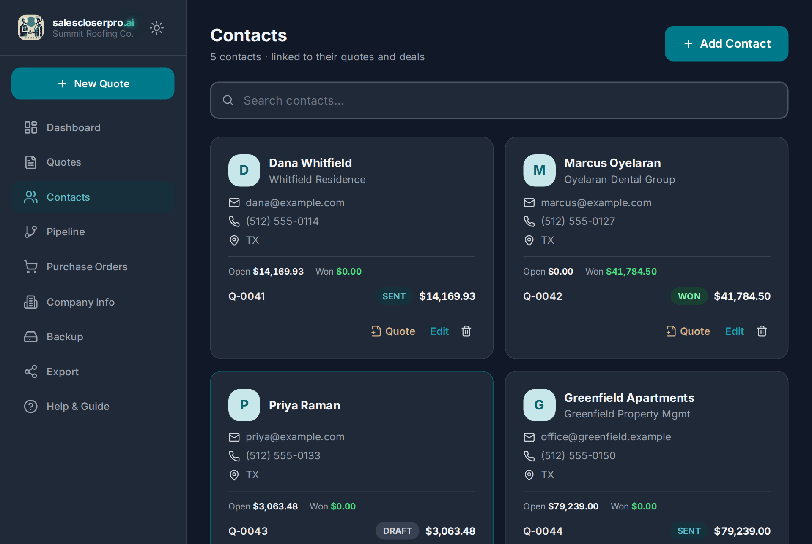
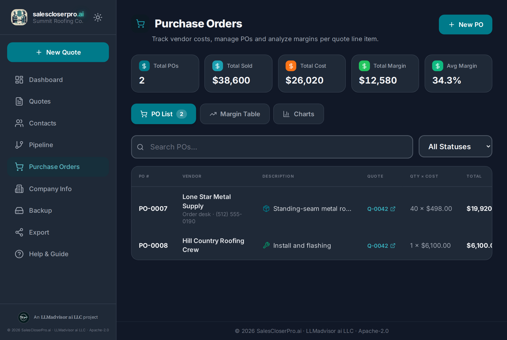
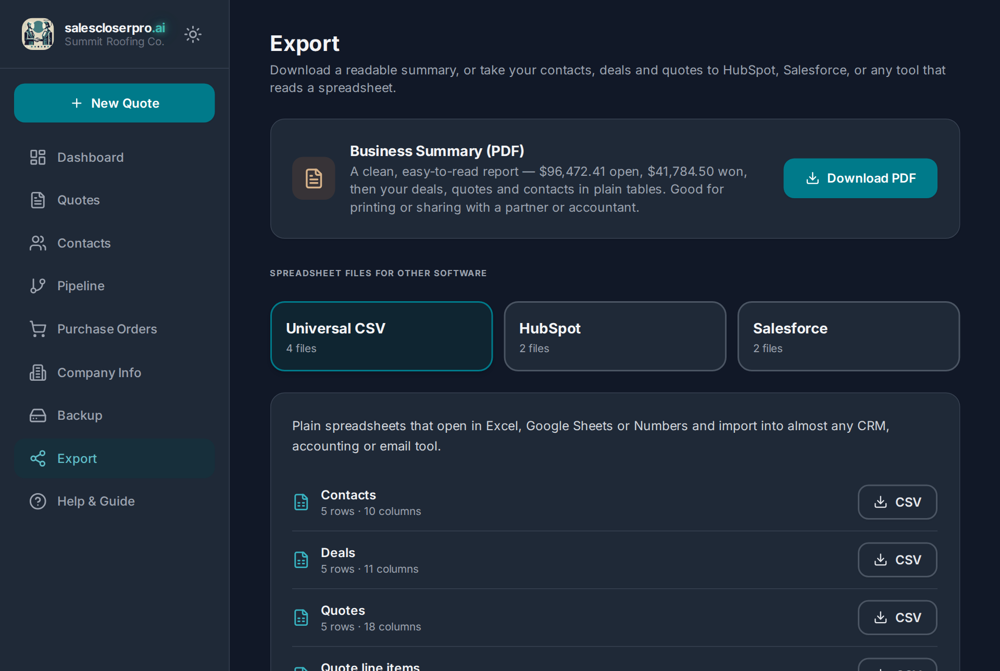
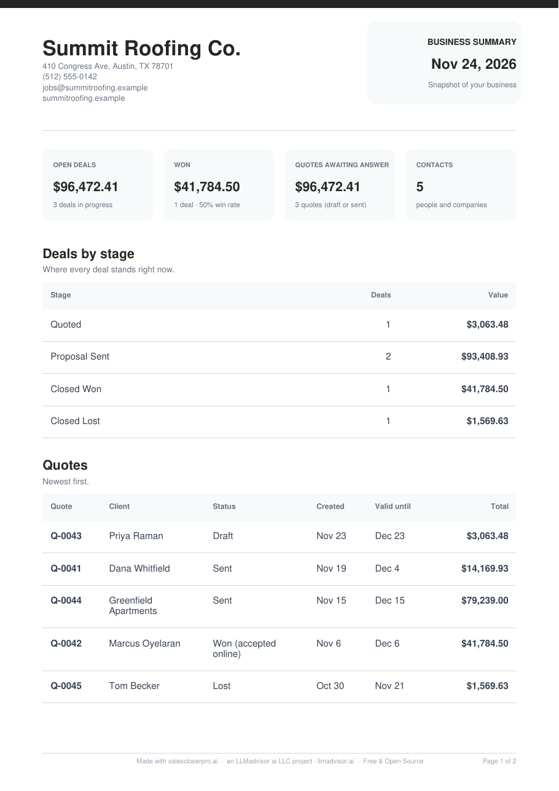
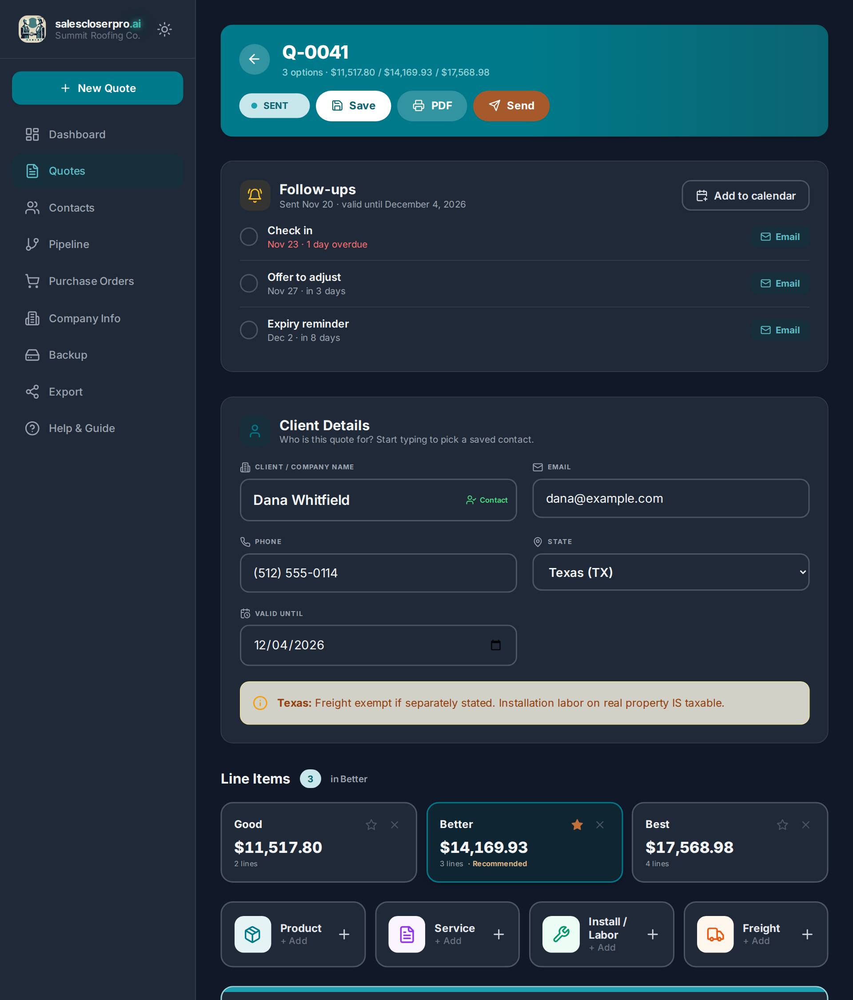
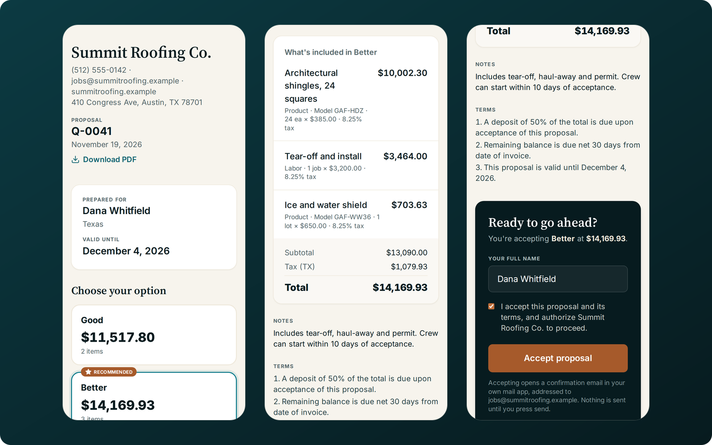
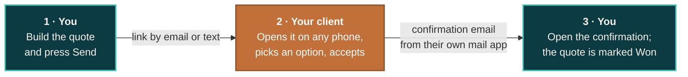

<p align="center">
  
</p>

<h1 align="center">salescloserpro.ai</h1>

<p align="center">
  <strong>The free CRM. Designed for simplicity.</strong><br />
  Quote, send, get the yes, and follow up — entirely in your browser.
</p>

<p align="center">
  <a href="https://salescloserpro.ai"><strong>salescloserpro.ai</strong></a> ·
  <a href="CHANGELOG.md">Changelog</a> ·
  <a href="DEPLOYMENT.md">Deployment</a> ·
  <a href="SECURITY.md">Security</a>
</p>

<p align="center">
  <a href="LICENSE"></a>
  
  
  
</p>

<p align="center">
  
</p>

---

## 

**salescloserpro.ai** is a sales tool for freelancers, contractors and small businesses. You build a
quote, send the client a link, they accept from their phone, and the deal moves through your
pipeline — with follow-up reminders for the ones that have not answered yet.

> [!NOTE]
> There is no account, no subscription and no server. Everything you enter is stored in your own
> browser, and the app is free and open source under Apache-2.0.

## 

| | |
|---|---|
|  | **Send** creates a link that carries the proposal inside itself. The client reviews it, picks an option and accepts; you get the confirmation by email and one click marks the quote Won. |
|  | Up to three priced options in one proposal, with a recommended pick. |
|  | Valid-until dates, a day-3 / day-7 / before-expiry schedule, drafted emails, and calendar export. |
|  | Every quote and deal links to a contact; each contact shows their quotes, deals and totals. |
|  | A plain-language Business Summary PDF, plus CSV files laid out for HubSpot, Salesforce or anything else. |
|  | Optional on product lines; carried to the PDF, the client page, purchase orders and exports. |
|  | Files are checked by content, images are re-encoded, PDFs are screened for active content. |
|  | The LLMadvisor ai LLC identity: teal, bone and copper, with serif headings. |

Full details are in the [changelog](CHANGELOG.md).

## 

All screenshots use made-up demo data and are generated by `npm run screenshots`.

<table>
  <tr>
    <td width="50%"><br /><sub><b>Dashboard</b> — follow-ups due today, then the numbers</sub></td>
    <td width="50%"><br /><sub><b>Pipeline</b> — every quote is a deal, linked to its contact</sub></td>
  </tr>
  <tr>
    <td><br /><sub><b>Contacts</b> — each person's quotes, deals and totals</sub></td>
    <td><br /><sub><b>Purchase orders</b> — vendor cost against what you sold it for</sub></td>
  </tr>
  <tr>
    <td><br /><sub><b>Export</b> — summary PDF and CRM-ready spreadsheets</sub></td>
    <td><br /><sub><b>Business Summary</b> — the report anyone can read</sub></td>
  </tr>
</table>

<table>
  <tr>
    <td width="70%" valign="top"><br /><sub><b>Quote builder</b> — follow-ups, contact picker, and Good / Better / Best</sub></td>
    <td width="30%" valign="top"><br /><sub><b>What the client sees</b> — on any phone, no app, no account</sub></td>
  </tr>
</table>

## 

| Area | What you get |
|---|---|
| **Quotes** | Product, service, labor and freight lines; sales tax for all 50 states and DC worked out per line; optional model numbers; attachments; sequential numbers that are never reused. |
| **Options** | Good / Better / Best — each option fully priced on the PDF and the client page. |
| **Sending** | A proposal link, a ready-to-send email draft, and a PDF with a clickable accept link. |
| **Acceptance** | The client picks an option and accepts by name. A version code confirms they accepted exactly what you sent, and warns you if you edited the quote afterwards. |
| **Follow-ups** | Reminders on the dashboard and the quote, drafted follow-up emails, and `.ics` export for Google, Outlook and Apple calendars. |
| **Contacts** | Type-ahead picker on quotes and deals; contacts are created or matched automatically when you save. |
| **Pipeline** | Lead → Quoted → Proposal Sent → Negotiating → Won / Lost, kept in step with quote status. |
| **Purchase orders** | Vendor POs linked to quote lines, with margin tables and charts. |
| **PDFs** | Proposals, purchase orders and the Business Summary share one clean layout with your logo. |
| **Export** | CSV in HubSpot, Salesforce and universal layouts. Files are made on your device; nothing connects to those services. |
| **Backup** | One-file backup and restore, with optional scheduled backups to a folder you choose. |
| **Everywhere** | Dark and light themes, phone-friendly screens, a built-in searchable help guide. |

## 



1. **Send** packs the quote into the link itself, after the `#`. Browsers never transmit that
   part of a link, so the proposal is not uploaded to the app, to the host, or to anyone.
2. The client opens the link, chooses an option, types their name and accepts. That drafts a
   confirmation email in **their own** mail app, addressed to you.
3. You open the link in that email. The app matches it to your quote, checks the version code,
   and records the acceptance.

> [!IMPORTANT]
> Anyone who has the link can read the proposal, exactly like an emailed PDF — send it only to
> your client. Logos and attachments are not included in the link.

## 

| | |
|---|---|
| **Where it lives** | Your browser's IndexedDB, on your device. Clearing site data erases it — use **Backup**. |
| **What leaves your device** | Nothing, unless you send it: proposal links, emails from your own mail app, and files you download. |
| **Third parties** | The site is served by Cloudflare, and two typefaces load from Google Fonts. There are no analytics, ads or trackers. |
| **Moving devices** | Backup on one device, Restore on the other. There is no cloud sync. |

> [!WARNING]
> Your data lives only in this browser. Clearing site data erases it — download a backup regularly.

## 

Requires Node 20 or newer (the repo pins Node 24 in `.nvmrc`).

```bash
git clone https://github.com/harborglowvintage-oss/salescloserpro.ai.git
cd salescloserpro.ai
npm install
npm run dev        # http://localhost:5173
```

| Script | What it does |
|---|---|
| `npm run dev` | Development server with hot reload |
| `npm run build` | Production build into `dist/` |
| `npm run preview` | Serve the production build locally |
| `npm test` | Unit tests for pricing, proposal links, follow-ups, exports and upload safety |
| `npm run test:e2e` | Browser tests for every user flow (setup notes in [`tests/run-e2e.mjs`](tests/run-e2e.mjs)) |
| `npm run screenshots` | Regenerate `screenshots/` from demo data |
| `npm run generate-images` | Rebuild the social card and logos from `brand/` |

> [!TIP]
> To host your own copy, see [DEPLOYMENT.md](DEPLOYMENT.md). Forks must use their own name and
> logo — see [CONTRIBUTING.md](CONTRIBUTING.md).

## 

```text
├── index.html                 App shell, SEO and social meta, structured data
├── tailwind.config.js         Brand tokens (colours, typefaces, animations)
├── brand/                     Source artwork — everything in public/logos is generated from here
├── public/                    Static files served as-is (icons, social card, headers, policy files)
├── docs/readme/               README section banners (generated)
├── screenshots/               README images (generated)
├── scripts/                   generate-brand-images.mjs
├── tests/
│   ├── unit/                  Pure-module tests
│   └── e2e/                   Browser flows, fixtures, screenshot generator
└── src/
    ├── App.jsx                Routes
    ├── store.js               All app state (Zustand, persisted to IndexedDB)
    ├── db.js                  IndexedDB adapter
    ├── data/taxDatabase.js    State sales-tax rates and rules
    ├── utils/
    │   ├── quoteMath.js       The one place quote money is calculated
    │   ├── pdfExport.js       Proposal and purchase-order PDFs, shared drawing helpers
    │   ├── reportPdf.js       Business Summary PDF
    │   ├── proposalLink.js    Proposal links, acceptance records, version codes
    │   ├── followUps.js       Follow-up schedule and calendar export
    │   ├── emails.js          Every drafted email
    │   ├── contacts.js        Contact matching and activity roll-up
    │   ├── crmExport.js       CSV export engine and per-CRM column maps
    │   ├── fileSafety.js      The gate every uploaded or restored file passes through
    │   └── dates.js · download.js
    └── components/
        ├── brand/             Logo, wordmark, LLMadvisor credit
        ├── landing/           Public pages: home, about, services, legal
        ├── layout/            App shell and navigation
        ├── dashboard/ · quotes/ · contacts/ · pipeline/ · po/
        ├── followups/ · proposal/ · export/ · backup/ · settings/ · help/
```

Built with React 18, Vite, Tailwind CSS, Zustand, Dexie, jsPDF and lucide-react.

## 

> [!CAUTION]
> **Sales tax is a starting point, not advice.** Rates are built in for convenience; confirm
> them with your accountant before you invoice.

- **Terms on proposals are fixed** (50% deposit, net 30). Add anything else in the notes.
- **United States only for now** — US dollars and US state tax.
- **Export is one-way.** Files go to HubSpot or Salesforce through their own import tools;
  changes made there do not come back.

## 

### Custom work

Need it tailored, white-labelled or set up for a team? See
[salescloserpro.ai/services](https://salescloserpro.ai/services).

### Contributing and security

Contributions are welcome — read [CONTRIBUTING.md](CONTRIBUTING.md) first. To report a
vulnerability, follow [SECURITY.md](SECURITY.md) rather than opening a public issue.

### License

Apache-2.0 — see [LICENSE](LICENSE) and [NOTICE](NOTICE).

Copyright © 2026 LLMadvisor ai LLC. "salescloserpro.ai" and "LLMadvisor" are trademarks of
LLMadvisor ai LLC; the license covers the code, not the names or logos.

<p align="center"><sub>An <a href="https://llmadvisor.ai">LLMadvisor ai LLC</a> project</sub></p>
